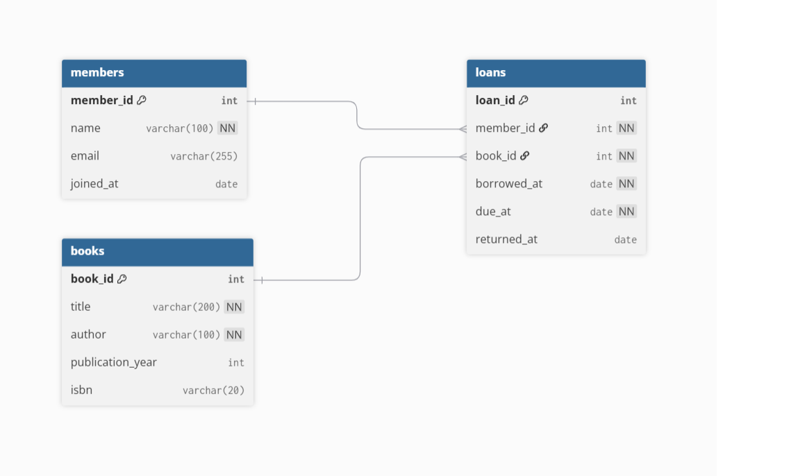
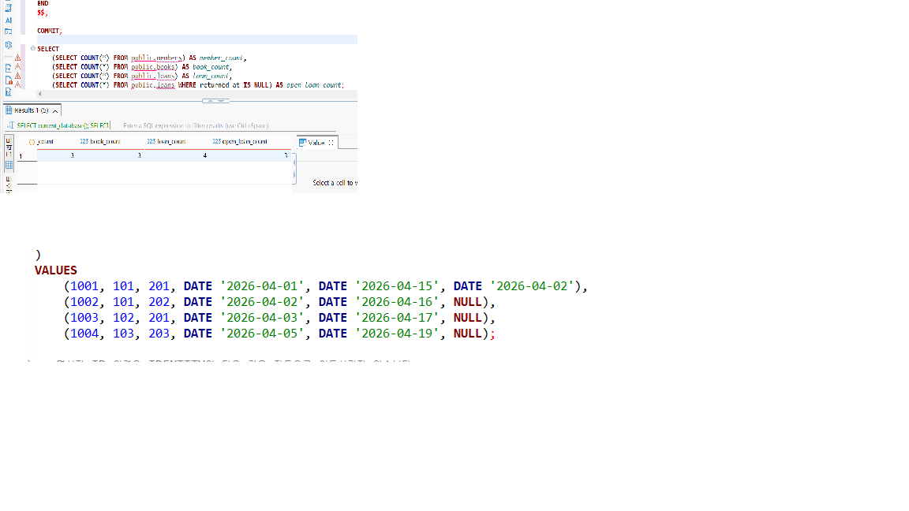
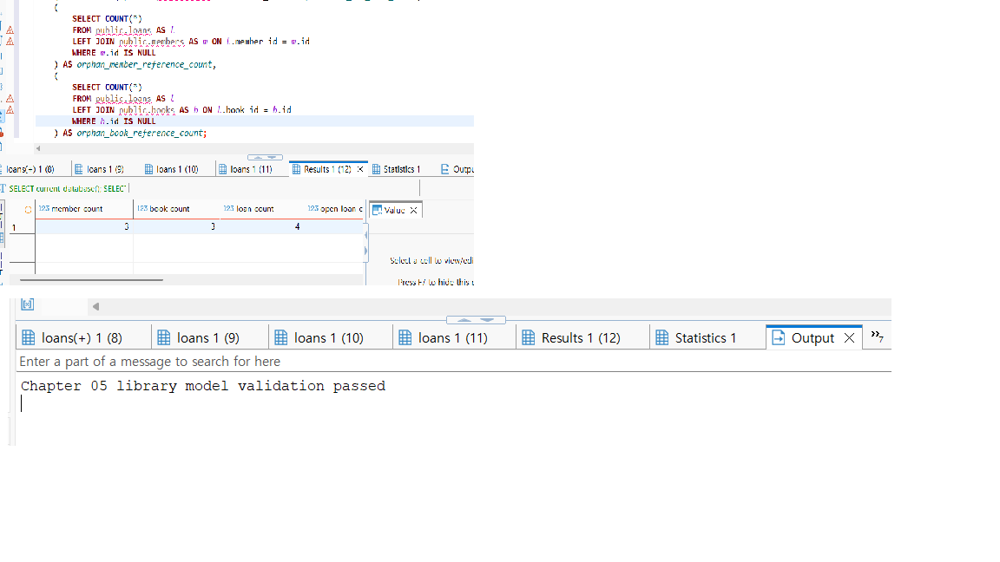
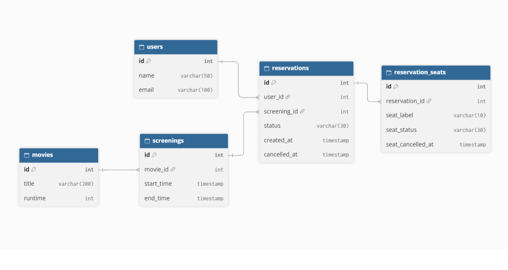

# Chapter 05 확장 실습 답안 템플릿

> **과제:** 요구사항에서 데이터 모델과 ERD 만들기  
> **사용 방법:** 이 파일을 내려받아 본인의 GitHub 저장소에 `chapter05_answer.md`라는 이름으로 저장한 뒤 실습하면서 바로 작성합니다.  
> **제출 방법:** LMS에는 파일을 직접 업로드하지 않고, **본인 GitHub 저장소의 `chapter05_answer.md` 파일 URL**을 제출합니다.

---

## 제출 전 주의

이 파일과 캡처 화면에는 실제 비밀번호, 전체 DB 접속 URL, API Key, 개인정보를 기록하지 않습니다.

```text
GitHub 계정 또는 별칭:chxxl
과제 작성일:10/12
사용한 AI 도구:gpt
```

---

# 1. Chapter 05 핵심 개념 복습

본문을 보지 않고 먼저 작성합니다.

```text
요구사항에서 바로 테이블부터 만들면 위험한 이유:서비스에서 필요한 기능과 데이터 간 관계를 충분히 파악하기 이전에 테이블을 만들면 중복되거나 누락된 데이터가 생길 수 있기 때문이다

한 행의 의미를 먼저 정해야 하는 이유:각 행이 무엇을 나타내는지 명확히 해야 어떤 데이터를 저장하고, pk는 무엇이고, 다른 테이블과의 어떤 관계를 맺을지 결정할 수 있기 때문이다

확정 요구사항과 미확정 정책을 구분해야 하는 이유:아직 결정되지 않은 정책을 확정된것으로 가정하고 설계하면 나중에 정책을 바꾸었을때 테이블 구조를 수정해야 할 수 있기때문이다

PK와 업무상 고유값 후보의 차이:pk는 테이블의 각 행을 구분하기 위해 선택한 기본키이다. 업무상 고유값 후보는 실제 업무에서 구분하기 위해 중복되면 안되는 값이다. 따라서 업무상 고유값 또한 pk가 될 수는있지만 무조건 pk로 해야하는것은 아니다. 보통은 id를 따로 둬서 pk로 지정한다.

N:M 관계를 그대로 두지 않고 연결 테이블을 검토하는 이유:n:m관계를 두 테이블의 fk만으로 직접 표현하기 어렵기 때문이다. 따라서 연결 테이블을 통해 n:m 관계를 1:n관계로 나누어 표현하고, 관계 자체의 정보도 저장할 수 있다.
```

---

# 2. 도서 대여 요구사항 R-01~R-07 다시 분해

| 요구사항 | 관리 대상 / 사건 | 속성 후보 | 관계 / 규칙 후보 | 미확정 질문 |
| --- | --- | --- | --- | --- |
| R-01 |회원|회원id||회원탈퇴는 고려하는가|
| R-02 |회원|이름,이메일,가입일|이메일은 고유값으로 관리|이메일 null허용하는가|
| R-03 |도서|제목,저자,출판연도,isbn|출판연도와 isbn은 null 가능|동일한 도서가 여러권있으면 어떡하는가|
| R-04 |대여|회원id,도서id|회원1명은 여러권을 대여할수있다|인당 최대 대여권수가 있는가|
| R-05 |대여|도서id|도서1권은 여러번 대여될수있다||
| R-06 |대여기록|대여일,반남예정일,실제반납일|대여기록은 회원 및 도서랑 연결됨||
| R-07 |대여기록|실제반납일|미반남 상태에서는 실제반납일 null|  |

### 본문과 비교한 뒤 수정한 내용

```text
처음에 놓친 부분:미확정 질문들에 대한 부분을 놓쳤다

처음에 잘못 분류한 부분:대여를 회원과 도서 사이의 관계로만 생각했지만 대여일과 반납일 등의 속성을 가진 별도의 기록으로 관리해야하는 부분을 잘못했다

수정한 이유:데이터의 관계와 제약조건을 명확히 해야 오류없이 데이터를 관리할 수 있다
```

---

# 3. 확정 규칙과 미확정 정책 구분

## 3-1. 확정된 규칙

```text
1.회원과 도서를 관리한다
2.대여 기록은 회원과 도서를 연결한다
3.대여일과 반납예정일을 저장한다
4.실제반납일은 비어 있을 수 있다
5.한 회원과 한 도서는 시간에 따라 여러 대여 기록을 가질 수 있다
```

## 3-2. 미확정 질문

최소 5개를 작성합니다.

```text
Q1.회원 삭제 후 대여 이력은 유지할것인가?
Q2.동시에 같은 책을 두 사람이 빌릴 수 있는가?
Q3.회원 한 명의 최대 대여 권수?
Q4.한 도서에 저자가 여러 명일 수 있는가?
Q5.isbn 없는 도서를 등록할 수 있는가?
```

### 미확정 정책을 바로 `UNIQUE`, `CHECK`, 삭제 규칙으로 구현하면 위험한 이유

```아직 결정되지 않은 정책을 제약조건으로 설정하면, 실제로 허용해야 하는 데이터까지 제한하거나 필요한 데이터를 삭제할 수 있기 때문이다. 그래서 나중에 정책이 변경되면 제약조건과 테이블 구조를 다시 수정해야 할 수 있다.

```

---

# 4. 엔터티·속성·사건 후보 구분

| 후보 | 대상 엔터티 / 사건 엔터티 / 속성 | 판단 근거 | 독립 식별 필요? |
| --- | --- | --- | --- |
| 회원 |대상 엔터티|회원마다 여러 속성들을 가지며 개별적으로 관리해야됨|필요|
| 도서 |대상 엔터티|도서마다 여러 속성들을 가지며 개별적으로 관리해야됨|필요|
| 대여 기록 |사건 엔터티|회원이 도서를 빌리때 마다 발생하는 사건이기 때문|필요|
| 이메일 |속성|회원의 정보로, 회원 엔터티에 속함|불필요|
| ISBN |속성|도서를 식별하는데 사용하는 정보로, 도서 엔터티에 속함|불필요|
| 반납예정일 |속성|대여 기록에 대한 정보로, 대여 기록 엔터티에 속함|불필요|

### “명사가 보이면 무조건 테이블”이 아닌 이유

```명사라고 하더라도 무조건 독립적으로 관리해야 하는 대상이 아닐수 있기 때문이다. 다른 대상에 속하는 정보로 별도의 테이블이 아닌 속성으로서 넣어야할수 있다.

```

---

# 5. 테이블별 한 행의 의미와 키 후보

| 테이블 | 한 행의 의미 | PK 후보 | 업무상 고유값 후보 | FK 후보 |
| --- | --- | --- | --- | --- |
| `members` |회원 한 명|id|email|없음|
| `books` |도서 한 권|id|isbn|없음|
| `loans` |특정 회원이 도서 한권을 빌린 사건 한 건|id|없음|member_id,book_id|

### `members.email`을 지금 바로 UNIQUE라고 확정하지 않는 이유

```보통 email은 고유하게 관리를 하는게 적절하지만, 요구사항에서 이메일의 중복을 금지하는 정책이 명시되어있지 않기 때문이다

```

### `books.isbn`을 지금 바로 NOT NULL + UNIQUE라고 확정하지 않는 이유

```요구사항에서 isbn은 무조건 값을 가져야 한다고 명시되어 있지 않기 때문이다. 또한 동일한 isbn를 가진 도서들에 대한 정책도 확정되어있지 않기 때문이다.

```

---

# 6. 관계를 양방향 문장으로 작성

## 6-1. `members ↔ loans`

```text
회원 한 명은 여러 대여 기록을 가질 수 있다.

대여 기록 한 건은 정확히 한 회원을 참조한다.

카디널리티:members 1 ── N loans
선택성에서 확인할 점:대여기록이 없는 회원도 존재할 수 있는가
```

## 6-2. `books ↔ loans`

```text
도서 한 건은 시간에 따라 여러 대여 기록을 가질 수 있다.

대여 기록 한 건은 정확히 한 도서를 참조한다.

카디널리티:books 1 ── N loans
선택성에서 확인할 점:한 번도 대여되지 않은 도서도 존재할 수 있는가
```

## 6-3. `members ↔ books`를 직접 N:M으로 저장하지 않고 `loans`를 두는 이유

```직접 n:m으로 저장하면 테이블의 한 행에 여러 회원 id나 도서 id를 저장해야 하는 문제가 발생할 수 있다.그래서 각 대여마다 달라지는 정보들도 관리하기 어렵기 때문에, loans라는 테이블을 별도로 두어서 사건마다 한 행으로 저장하고 데이터를 관리한다.

```

### `loans`가 단순 연결표가 아니라 사건 엔터티라고 볼 수 있는 이유

```loans가 단순히 회원과 도서를 연결하는 것이 아니라, 대여일, 반납예정일과 같은 정보들을 저장하기 때문이다. 따라서 사건 엔터티로 봐야된다.

```

---

# 7. 도서 대여 ERD 초안

아래 항목이 보이도록 ERD를 작성합니다.

```text
members
books
loans
PK
FK
주요 속성
1:N 관계
```

권장 이미지 경로:

```text
assignments/chapter05/images/step07_library_erd.png
```

Markdown 예시:

```markdown

```

`여기에 ERD 이미지를 삽입하세요.`


### ERD를 그린 뒤 수정한 부분

```필요한 속성들을 추가해서 수정했다

```

---

# 8. PostgreSQL로 도서 대여 모델 구현 확인

## 8-1. 현재 환경 확인

```sql
SELECT current_database();
SELECT current_user;
SELECT current_schema();
SHOW search_path;
SHOW transaction_read_only;
```

```text
현재 DB:ai_database_book
현재 사용자:postgres
현재 스키마:public
search_path:public, "$user"
읽기 전용 여부:off
```

- [o] 현재 DB가 `ai_database_book`이다.
- [o] 실행 범위를 확인했다.
- [o] Auto-commit 상태를 확인했다.

## 8-2. 스키마 생성 SQL 실행

사용 파일:

```text
code/chapter05/01_library_schema.sql
```

실행 전 예상:

```text
생성될 테이블 수:3
생성 순서:members -> books -> loans
각 테이블 예상 행 수:0행
```

실행 후 실제:

```text
members 존재:존재한다
books 존재:존재한다
loans 존재:존재한다
각 테이블 행 수:0행
```

### `loans`를 마지막에 만드는 이유

```loans 테이블은 members와 books 테이블의 pk를 fk로 참조하기 때문이다. 따라서 참조 대상인 두 테이블을 먼저 만들어야 관계가 정상적으로 설정된다

```

---

# 9. 샘플 데이터 입력과 관계 관찰

사용 파일:

```text
code/chapter05/02_library_seed.sql
```

## 9-1. 실행 전 예상

```text
members 예상 행 수:3
books 예상 행 수:3
loans 예상 행 수:4
미반납 예상 건수:3
회원 101 대여 예상 건수:2
도서 201 대여 예상 건수:2
```

## 9-2. 실제 결과

```text
members 실제 행 수:3
books 실제 행 수:3
loans 실제 행 수:4
미반납 실제 건수:3
회원 101 대여 실제 건수:2
도서 201 대여 실제 건수:2
```

### 샘플 데이터에서 확인한 1:N 관계

```회원 101의 대여 건수가 2개이므로 1:N관계를 가지고 있다. 또한 도서 201의 대여 건수가 2개이므로 1:N관계를 가지고 있다.

```

### `returned_at = NULL`이 의미하는 것

```실제 반납일이 아직 기록되지 않았다는 의미이다. 이 시스템에서는 아직 반납하지 않은 상태로 해석한다.

```

### 증거 화면

권장 경로:

```text
assignments/chapter05/images/step09_seed_result.png
```



---

# 10. 검증 SQL 실행

사용 파일:

```text
code/chapter05/03_library_validation.sql
```

## 10-1. 결과 기록

```text
members =3
books =3
loans =4
미반납 건수 =3
회원 101 대여 이력 =2
도서 201 대여 이력 =2
회원 참조 고아 행 =0
도서 참조 고아 행 =0
loans FK 개수 =2개
검증 최종 메시지 =Chapter 05 library model validation passed
```

### 단순히 테이블 3개가 생성되었다고 설계 검증이 끝난 것이 아닌 이유

```단순히 테이블이 3개라고 fk가 제대로 연결되었는지, 샘플 관계가 요구사항대로 저장되었는지, 미반납 상태가 표시되었는지를 확인할 수 없기 때문이다.

```

### 증거 화면

권장 경로:

```text
assignments/chapter05/images/step10_validation.png
```



---

# 11. 작은 시나리오로 모델 검증

아래 시나리오를 현재 모델이 표현할 수 있는지 판단합니다.

| 시나리오 | 표현 가능? | 이유 | 추가 확인할 정책 |
| --- | --- | --- | --- |
| 회원 A가 서로 다른 책 2권을 대여 |가능|loans에 같은 member_id로 서로 다른 boo_id를 저장할수있다|최대 대여 권수|
| 같은 책을 시간 차를 두고 다시 대여 |가능|같은 book_id로 여러 대여 기록을 만들수 있다|다시 대여 제한 여부|
| 아직 반납하지 않은 대여 |가능|returned_at에 null을 저장할 수 있다|반납기한 기준|
| 회원은 있지만 대여 기록이 없음 |가능|members에 대여기록없으 회원을 등록할수있다|  |
| ISBN이 없는 도서 |가능|isbn에 null을 허용한다|isbn이 없는 도서의 등록기준|
| 같은 ISBN의 실물 복본 2권 |가능은한데 제한이 있다|isbn에 unique가 없어서 같은 isbn이지만 id를 다르게 입력하면 된다. 그러나 결국 동일한 실물책을 비효율적으로 데이터에 입력하게 되는 한계가있다|동일한 isbn이 허용된다면, 이를 관리할 새로운 table을 만든다|
| 한 도서에 저자 2명 |가능은한데 제한이 있다|저자 칼럼에 저자 2명을 넣으면 되긴 하지만, 각 저자들을 독립적인 데이터로서 관리하는것이 어렵다.|한 도서에 저자2명을 허용하면 저자 테이블 생성 필요여부|
| 같은 도서를 두 명이 동시에 대여 |가능은한데 문제가 있다|동일한 book_id로 두명이 동시에 대여를 할 수는 있지만, 해당 도서가 몇권이 있냐에 따라서 문제가 발생한다.|동시대여 규칙을 확인해야된다|

### 현재 Chapter 05 모델의 한계 3가지

```text
1.동일한 isbn을 가진 실물 도서가 여러권 있을때, 현재 테이블에서는 각 도서들의 공통 정보들을 중복으로 저장하게 되는 비효율이 존재한다
2.한 도서에 저자가 여러명일 경우, 저자 여러명을 하나의 문자열로 저장해야 하므로, 각 저자들을 독립적으로 관리하기 어렵다
3.동일한 도서에 대해 두명이 동시에 대여하는것을 방지하는 제약조건이 현재는 없으므로, 만약 책이 한권밖에 없다면 문제가 발생한다.
```

---

# 12. Chapter 01~04 개인 서비스 요구사항 작성

지금까지 선택한 개인 서비스 아이디어를 사용합니다.

```text
서비스 이름:
서비스 목적:
```

## 12-1. 요구사항

최소 8개를 작성합니다.

```text
P05-R01.서비스는 사용자를 관리하며, 이름, 이메일, 비밀번호, 연락처, 가입일을 저장한다
P05-R02.서비스는 영화를 관리하며, 제목, 상영시간, 관람등급, 개봉일을 저장한다
P05-R03.서비스는 영화관을 관리하며, 영화관의 이름, 주소 등을 저장한다
P05-R04.하나의 영화관은 여러 상영관을 가지며, 각 상영관은 하나의 영화관에 속한다
P05-R05.각 상영관은 여러 좌석을 가지며, 좌석번호, 행, 열 등의 정보를 저장한다
P05-R06.하나의 영화는 여러 상영일정을 가지며, 각 상영일정은 하나의 영화와 하나의 상영관에 연결된다
P05-R07.상영일정에는 상영 시작시간과 종료시간 등의 정보를 저장한다
P05-R08.사용자는 특정 상영일정을 선택하여 여러 좌석을 한번에 예매할 수 있다
P05-R09.동일한 상영일정에서 동일한 좌석이 중복으로 예매되는것을 방지해야된다
P05-R10.예매기록에는 사용자,상영일정,예매상태,예매일시 등을 저장한다
P05-R11.사용자는 예매한 좌석 중 일부만 취소하거나 전체를 취소할 수 있으며, 취소상태와 취소일시를 저장한다
P05-R12.사용자는 영화에 대한 리뷰를 작성할 수 있으며,평점, 내용, 작성일시를 저장한다
P05-R13.각 리뷰는 사용자 한명과 영화 한개에 연결된다
```

> 화면 기능보다 **저장해야 할 사실, 반복 사건, 상태와 관계**를 중심으로 작성합니다.

## 12-2. 미확정 질문

최소 3개를 작성합니다.

```text
P05-Q01.영화 상영 몇분 전까지 예매와 취소를 허용할것인가 
P05-Q02.사용자는 실제로 예매한 영화에 대해서만 리뷰를 작성할수있는가
P05-Q03.사용자 한명이 동일한 영화에 리뷰를 여러개 작설할수있는가
```

---

# 13. 개인 서비스 모델 초안

## 13-1. 엔터티·사건 후보표

| 후보 | 대상 / 사건 | 한 행의 의미 | 주요 속성 | PK 후보 | 업무 식별자 후보 |
| --- | --- | --- | --- | --- | --- |
|users|대상|사용자 한명|이름,이메일,비밀번호,가입일|user_id|이메일|
|movies|대상|영화 한편|제목,상영시간,관람등급,개봉일|movie_id|x|
|screenings|대상|특정 상영관에서 특정 시간에 진행되는 영화 한 건|영화id,상영관id,시작시간,종료시간|screening_id|x|
|reservations|사건|특정 사용자가 특정 상영일정에 대한 예매 한건|사용자id,상영일정id,예매상태|reservation_id|x|

## 13-2. 관계 문장

최소 3쌍을 양방향으로 작성합니다.

```text
관계 1: useres <->reservations
사용자 한명은 여러 예매 기록을 가질수있다
예매 기록 한건은 한 사용자를 참조한다

관계 2:movies<->screenings
영화 한편은 여러 상영일정을 가질 수 있다
상영일정은 한 영화를 참조한다

관계 3:screenings<->reservations
상영일정 한건은 여러 예매기록을 가질수있다
예매 기록 한건은 한 상영일정을 참조한다

## 13-3. N:M 관계 검토

```text
N:M 관계 후보: reservations <-> seats
연결 테이블 후보: reservation_seats
연결 테이블 한 행의 의미: 특정 예매에 포함된 좌석 한 개의 기록을 의미
연결 테이블 자체에 필요한 사건 속성:좌석별 예매상태, 좌석별 취소일시
```

---

# 14. 개인 서비스 ERD 초안

ERD에 최소 다음을 표시합니다.

```text
테이블 3개 이상
각 테이블 PK
주요 속성
필요한 FK
관계선
카디널리티
```

권장 이미지 경로:

```text
assignments/chapter05/images/step14_my_erd.png
```



### ERD의 각 테이블이 어떤 요구사항에서 나왔는지 설명

| 테이블 | 근거 요구사항 ID | 한 행의 의미 |
| --- | --- | --- |
|users|P05-R01, R08, R10|사용자 한 명|
|movies|P05-R02, R06, R12|영화 한 편|
|screenings|P05-R06, R07, R08|특정 영화의 상영 일정 한 건|
| reservations | P05-R08, R10, R11 | 사용자가 특정 상영 일정을 예매한 기록 한 건 |
| reservation_seats | P05-R08, R11 | 특정 예매에 포함된 좌석 한 건 |
---

# 15. 요구사항 추적표

| 요구사항 ID | 데이터 모델 반영 위치 | 검증 방법 | 상태 |
| --- | --- | --- | --- |
| P05-R01 |users|사용자 이름, 이메일, 비밀번호, 연락처, 가입일을 저장할 수 있는지 확인| 반영/미반영/확인필요 |
| P05-R02 |movies |영화 제목, 상영시간, 관람등급, 개봉일을 저장할 수 있는지 확인 |  |
| P05-R06 |movies, screenings|하나의 영화에 여러 상영 일정을 연결하고, 각 일정에 상영관도 연결할 수 있는지 확인|  |
| P05-R07 |screenings|상영 시작시간과 종료시간을 저장할 수 있는지 확인|  |
| P05-R08 |reservations, reservation_seats|하나의 예매에 여러 좌석을 연결할 수 있는지 확인|  |
| P05-R10 |reservations|예매별 사용자, 상영 일정, 예매 상태, 예매일시를 확인|  |
| P05-R11 |reservations, reservation_seats|일부 좌석 취소 시 나머지 좌석이 유지되고, 전체 취소 시 예매 기록이 보존되는지 확인|  |

현재 erd에서 주요 테이블을 부분적으로 만들었기 때문에, 이러한 구조적인 이유로 반영되지 못한 요구사항들은 일부 제외했습니다.


### ERD 그림만으로 요구사항 누락을 발견하기 어려운 이유

```erd는 테이블의 구조와 관계를 보여주지만, 원래 요구사항이 모두 반영되었는지는 직접 보여주지 않기 때문이다. 따라서 요구사항과 erd를 하나씩 비교하지 않으면, 필요한 테이블이나 속성이 누락되었는지 업무 규칙이 제대로 반영되었는지 확인하기 어렵다.

```

---

# 16. 개인 서비스 작은 데이터 시나리오 검증

가상 데이터만 사용합니다.

```text
사용자/대상 A:사용자1
사용자/대상 B:사용자2
대상 X:영화a
대상 Y:영화b
사건 1:사용자1이 10일 14시 영화a 좌석n1 n2를 예매했다
사건 2:사용자1이 10일 16시 영화b 좌석n1을 예매했다
사건 3:사용자1이 10일 14시 영화a 좌석 n2를 예매취소했다
```

### 이 시나리오를 현재 ERD로 저장할 수 있는가?

```가능하다. 현재 erd로 다 저장가능한 시나리오다

```

### 저장하기 어려운 상황 또는 모호한 부분

```현재 ERD는 전체 9개 테이블 중 핵심 5개 테이블만 반영한 간소화된 모델이다. 따라서 좌석번호를 reservation_seats에 직접 저장하므로 상영관별 좌석 정보를 독립적으로 관리하기 어렵다. 또한 동일한 상영 일정에서 같은 좌석이 여러 예매에 포함되는 것을 방지하는 제약조건이 아직 구현되어 있지 않다.

```

### 시나리오 검증 후 수정한 ERD 내용

```현재 erd 구성은 유지하면서 추가적인 필요한 테이블들을 erd에 추가할 예정이다.

```

---

# 17. AI를 설계자가 아니라 리뷰어로 활용

## 17-1. AI에게 전달한 핵심 자료

```text
요구사항:영화관 예매 서비스의 사용자, 영화, 상영 일정, 예매 및 좌석별 예매 관리 등에 관한 P05-R01~R13 요구사항

미확정 질문:
Q01. 상영 시작 몇 분 전까지 예매와 취소를 허용할 것인가?
Q02. 실제 예매한 영화에 대해서만 리뷰를 작성할 수 있는가?
Q03. 동일 사용자가 같은 영화에 리뷰를 여러 개 작성할 수 있는가?

테이블별 한 행 의미:users: 사용자 한 명, movies: 영화 한 편,screenings: 특정 영화의 상영 일정 한 건 ,reservations: 사용자의 예매 기록 한 건,reservation_seats: 특정 예매에 포함된 좌석 한 건

관계 문장:사용자 한 명은 여러 예매 기록을 가질 수 있고, 예매 한 건은 한 사용자에 속한다
영화 한 편은 여러 상영 일정을 가질 수 있고, 상영 일정 한 건은 한 영화를 참조한다
상영 일정 한 건은 여러 예매 기록을 가질 수 있고, 예매 한 건은 하나의 상영 일정을 참조한다
예매 한 건은 여러 좌석을 포함할 수 있고, 각 좌석별 예매 기록은 하나의 예매에 속한다

ERD 설명:전체 프로젝트는 9개 테이블로 설계했지만, chapter 05 실습에서는 users, movies, screenings, reservations, reservation_seats의 5개 테이블로 간소화하였다. 각 테이블의 PK, 필요한 FK, 주요 속성과 1 관계를 표현하였다
```

## 17-2. AI 검토 요청

실제로 사용한 프롬프트 또는 핵심 내용을 기록합니다.

```

나는 데이터베이스를 배우는 초보자입니다.
아래 요구사항과 내가 만든 데이터 모델을 검토해 주세요.
중요: 완성된 ERD를 대신 만들어 주지 마세요.
내 설계에서 확인해야 할 질문을 먼저 제시해 주세요.
다음 관점으로 검토해 주세요.
1. 요구사항에 없는 정책을 내가 임의로 확정했는지
2. 테이블 한 행의 의미가 모호한 곳
3. 대상과 사건을 섞은 곳
4. PK와 업무 식별자를 혼동한 곳
5. N:M인데 연결 엔터티가 빠진 곳
6. FK 방향이나 카디널리티가 이상한 곳
7. 미확정 질문으로 남겨야 할 부분
8. 작은 데이터 예제로 검증하면 좋을 상황
[요구사항]
영화관 예매 서비스의 사용자, 영화, 상영 일정, 예매 및 좌석별 예매 관리 등에 관한 P05-R01~R13 요구사항
[미확정 질문]
Q01. 상영 시작 몇 분 전까지 예매와 취소를 허용할 것인가?
Q02. 실제 예매한 영화에 대해서만 리뷰를 작성할 수 있는가?
Q03. 동일 사용자가 같은 영화에 리뷰를 여러 개 작성할 수 있는가?
[테이블별 한 행 의미]
users: 사용자 한 명, movies: 영화 한 편,screenings: 특정 영화의 상영 일정 한 건 ,reservations: 사용자의 예매 기록 한 건,reservation_seats: 특정 예매에 포함된 좌석 한 건
[관계 설명]
사용자 한 명은 여러 예매 기록을 가질 수 있고, 예매 한 건은 한 사용자에 속한다
영화 한 편은 여러 상영 일정을 가질 수 있고, 상영 일정 한 건은 한 영화를 참조한다
상영 일정 한 건은 여러 예매 기록을 가질 수 있고, 예매 한 건은 하나의 상영 일정을 참조한다
예매 한 건은 여러 좌석을 포함할 수 있고, 각 좌석별 예매 기록은 하나의 예매에 속한다

```

## 17-3. AI 제안 검토

| AI 제안 또는 질문 | 수용 / 수정 / 보류 / 거절 | 실제 근거 요구사항 | 나의 판단 이유 |
| --- | --- | --- | --- |
|요구사항에 없는 정책을 임의로 확정했는가?|수용| |미확정된 정책이 있으므로 이런것을 고려해야한다|
|대상 엔터티와 사건 엔터티를 적절히 구분했는가?|수용|  |대상 엔터티와 사건 엔터티는 구분할 필요가 있고, 현재는 잘 구분되어 있는 상태이다|


### AI가 요구사항에 없는 정책을 임의로 확정한 부분이 있었나요?

x
```

### AI 검토를 받고도 채택하지 않은 제안 하나와 그 이유

```아직 확정되지 않은 정책들에 관한것은 반영하지 않았다. 예를들어 한번에 예매할수있는 좌석수의 제한과 같은것들은 아직 어떻게 할지 확정하지 않은것이기 때문에 반영하지 않았다.

```

---

# 18. 선택 — PostgreSQL DDL 초안

> 이 단계는 완성된 구현이 아니라 **현재 데이터 모델을 SQL 구조로 옮겨 보는 연습**입니다. Chapter 06에서 정규화와 제약조건을 더 엄격하게 검토합니다.

```sql
-- 개인 서비스 DDL 초안

```

### 아직 구현하지 않은 미확정 정책

```text
1.영화 상영 시작 몇 분 전까지 예매와 취소를 허용할 것인가?
2.사용자는 실제로 예매한 영화에 대해서만 리뷰를 작성할 수 있는가?
3.사용자 한 명이 동일한 영화에 리뷰를 여러 개 작성할 수 있는가?
```

---

# 19. 최종 성찰

아래 문장은 반드시 본인의 말로 작성합니다.

```text
1. 요구사항에서 바로 테이블을 만들지 않고 중간 설계 과정을 거쳐야 하는 이유는
   서비스에 필요한 데이터와 관계를 충분히 파악하는것이 중요하기 때문 이다.

2. 테이블의 한 행 의미가 중요한 이유는
   각 테이블의 한 행이 무엇을 나타내는지 명확해야 구체적인 데이터를 잘 저장할수 있기때문 이다.

3. 미확정 정책을 그대로 남겨 두는 것이 좋은 설계 활동일 수 있는 이유는
   결정되지 않은 정책을 임의로 적용하면 오류가 발생할수 있기 때문 이다.

4. N:M 관계에서 연결 엔터티가 필요한 이유는
   두 테이블만으로는 여러 대상 사이의 관계를 관리하기 어렵기 때문 이다.

5. AI가 ERD를 만들어 주더라도 사람이 반드시 확인해야 하는 것은
   각 테이블의 관계가 정확한지, 실제 요구사항에 근거하는지 확인하기위해서 이다.
```

---

# 20. 제출 체크리스트

- [o] `chapter05_answer.md`를 본인 저장소에 만들었다.
- [o] R-01~R-07을 직접 재분해했다.
- [o] 확정 규칙과 미확정 질문을 구분했다.
- [o] `members/books/loans`의 한 행 의미를 설명했다.
- [o] 관계를 양방향 문장으로 작성했다.
- [o] 도서 대여 ERD를 작성했다.
- [o] `01_library_schema.sql`을 실행했다.
- [o] `02_library_seed.sql`을 실행했다.
- [o] `03_library_validation.sql` 결과를 확인했다.
- [o] 작은 시나리오로 모델의 한계를 확인했다.
- [o] 개인 서비스 요구사항을 8개 이상 작성했다.
- [o] 개인 서비스 미확정 질문을 3개 이상 작성했다.
- [o] 개인 서비스 ERD를 작성했다.
- [o] 요구사항 추적표를 작성했다.
- [o] 개인 서비스 작은 데이터 시나리오를 검증했다.
- [o] AI 제안을 수용/수정/보류/거절로 판단했다.
- [o] 핵심 캡처 또는 ERD 이미지 3~4장 이내로 정리했다.
- [o] 이미지가 GitHub 웹 화면에서 실제로 보인다.
- [o] 답안 파일을 commit/push했다.

---

# 21. LMS 제출 URL

아래 형식의 **본인 GitHub 파일 URL**을 LMS에 제출합니다.

```text
https://github.com/<본인-GitHub-ID>/<본인-저장소>/blob/main/assignments/chapter05/chapter05_answer.md
```

내 제출 URL:

```text

```

> 저장소 메인 URL, 교수자 템플릿 URL, Raw URL이 아니라 **작성 완료된 본인 `chapter05_answer.md` 파일 화면 URL**을 제출합니다.
